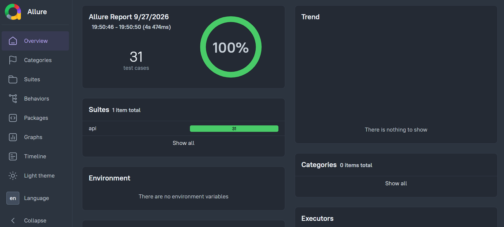

# FinTech API QA Automation Framework — Public Preview

This is a public preview

**The full source code — including the complete backend, all 31 automated tests, database validation helpers, CI/CD pipeline, and Docker setup — is private. This repository shows the architecture, a sample of the actual code, and the results, so you can evaluate the quality of the work before requesting access.**

Interested in the full framework, a custom version for your own project, or hiring for QA automation work? Reach out:

- Email: zaynkory00@gmail.com
- LinkedIn:
  www.linkedin.com/in/zaynab-kouri-26881643a

أ

- Instagram: z.k0r3

---

## What This Demonstrates

| Area                     | Implementation                                                               |
| ------------------------ | ---------------------------------------------------------------------------- |
| API Test Automation      | Playwright API testing with the Service Object Model pattern                 |
| Backend Engineering      | Express and TypeScript REST API with Prisma ORM                              |
| Financial Business Logic | Atomic transfers, balance validation, self-transfer prevention               |
| Database Testing         | Direct SQL assertions independent of the application's own ORM               |
| Security Testing         | JWT tampering, missing auth, account enumeration prevention, rate limiting   |
| CI/CD                    | GitHub Actions pipeline running migrations, seeding, and tests automatically |
| Containerization         | One-command Docker Compose environment                                       |
| Reporting                | Allure Report with step-level detail                                         |
| QA Documentation         | Structured bug report with root cause analysis                               |

## Project Structure

```
fintech-api-qa-framework/
├── server/                 Target API application under test
│   ├── src/
│   │   ├── config/         Environment, Prisma client, business rules
│   │   ├── controllers/    Auth and Wallet business logic
│   │   ├── middleware/     JWT verification, rate limiting
│   │   ├── routes/         Express route definitions
│   │   └── server.ts       Application entry point
│   └── prisma/             SQLite schema and seed script
│
├── tests/                  QA automation suite
│   ├── config/              Environment variables and endpoint paths
│   ├── helpers/
│   │   ├── auth.helper.ts   Login and token utilities
│   │   └── db.helper.ts     Direct SQLite assertions
│   ├── services/            Service Object Model API clients
│   └── specs/                Test scenarios (31 tests total)
│
├── .github/workflows/       CI pipeline
├── bug-reports/             QA documentation samples
├── docker-compose.yml
└── playwright.config.ts
```

## Business Rules Covered

`POST /api/wallet/transfer` enforces, in order: minimum transfer amount, self-transfer policy, receiver account existence, sufficient sender balance, and atomic execution of the debit, credit, and transaction record write inside a single Prisma interactive transaction, so a failure at any point leaves no partial write in the database.

## Test Coverage Summary

| Spec File                | Focus                                                                                                                                                                                                  | Test Count |
| ------------------------ | ------------------------------------------------------------------------------------------------------------------------------------------------------------------------------------------------------ | ---------- |
| 01-auth.spec.ts          | Login happy path, invalid credentials, missing fields, account enumeration prevention, token tampering                                                                                                 | 12         |
| 02-transfer.spec.ts      | Successful transfers, balance updates, negative and zero amounts, insufficient balance, self-transfer, nonexistent receiver, unauthenticated requests, property-based random amount testing with Faker | 13         |
| 03-db-validation.spec.ts | Transaction record integrity, balance arithmetic against raw SQL, atomicity on rejected transfers, API-to-database consistency                                                                         | 7          |

## Sample Code Included in This Preview

Two files are included in full to demonstrate code quality and testing depth:

- `server/src/controllers/wallet.controller.ts` — the actual transfer endpoint logic, including atomic Prisma transactions
- `tests/specs/02-transfer.spec.ts` — the actual transfer test suite, including edge cases and a property-based test using Faker

Every other file in this repository exists as a placeholder showing the project's real structure and scope. Full contents are available in the private repository upon request.

## Bug Reporting Sample

`bug-reports/BUG-001-sample.md` is included in full — a real, professionally documented defect (floating-point precision drift in monetary calculations) with root cause analysis and a suggested fix, demonstrating QA depth beyond writing passing tests.

## Test Results



All test suites passing, generated with Allure. See `screenshots/allure-test-detail.png` for step-level detail on an individual suite.
